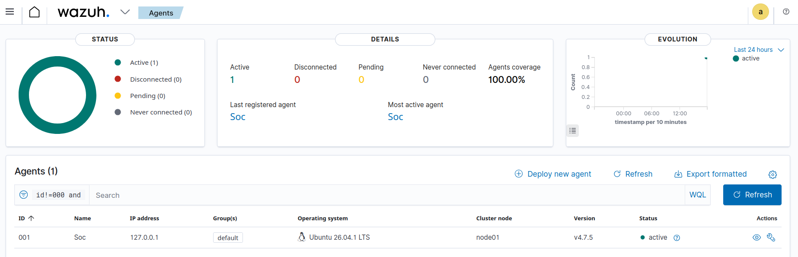

# 🛡️ SOC-Analyst-Lab: Практическая лаборатория Blue Team

Данный репозиторий содержит развернутую с нуля изолированную лабораторию для отработки навыков мониторинга, детектирования и реагирования на инциденты ИБ (SOC L1/L2).

**Цель проекта:** Не просто научиться нажимать кнопки в SIEM, а понять полный цикл жизни инцидента: от развертывания инфраструктуры до написания правил корреляции и снижения уровня ложных срабатываний (False Positives).

## 🛠️ Стек лаборатории
*   **Виртуализация:** VirtualBox, Ubuntu Server
*   **Контейнеризация:** Docker, Docker Compose
*   **SIEM:** Wazuh (Manager, Indexer, Dashboard)
*   **Агенты:** Linux-агент (сбор логов аутентификации, syslog)

## 🚀 Реализованные кейсы и навыки

### Кейс 1: Детектирование скрытого пользователя (Persistence)
*   **Сценарий:** Хакер получает доступ к системе и создает нового пользователя (`useradd`), добавляя его в группу `sudo`.
*   **Действие:** Написан комплекс правил на XML:
    *   `100200` (Level 8) — базовое оповещение о создании пользователя.
    *   `100201` (Level 12) — критический алерт при создании пользователя с подозрительным именем (root, admin, backup, test).
    *   `100202` (Level 12) — алерт на добавление в группу sudo.
    *   `100203` (Level 14) — правило корреляции для массового создания пользователей.
*   **Результат:** SIEM Wazuh успешно детектировал создание трех подозрительных учетных записей (`admin`, `backup`, `test`) и сгенерировал алерты уровня **12 (Critical)**.
*   **Ссылки:** 
    *   [Правила корреляции](./wazuh-rules/local_rules.xml)
    *   [Отчет об инциденте](./incident-reports/incident_report_T1136.md)

### Кейс 2: Оптимизация и снижение шума (Rule Tuning)
*   **Проблема:** Стандартные модули Wazuh (rootcheck, PAM) генерировали сотни событий уровня 3-7, что приводило к "усталости от алертов" (Alert Fatigue).
*   **Решение:** Проведен анализ логов и написаны правила-глушилки (уровень 0), которые скрывают системный шум, оставляя видимыми только критические инциденты.
*   **Результат:** Дашборд стал чистым, фокус смещен на реальные угрозы.

## 🖼️ Демонстрация работы

**1. Успешное подключение агента и статус Active:**

**2. Срабатывание кастомных правил и фильтрация шума:**

**3. Срабатывание EDR-правила (Детектирование Nmap через Auditd):**

### Кейс 3: Настройка Active Response (Автоматическая блокировка)
*   **Сценарий:** Множественные неудачные попытки входа по SSH (брутфорс).
*   **Действие:** Настроено кастомное правило (`100310`), которое при срабатывании передает команду агенту для запуска скрипта `firewall-drop`.
*   **Результат:** IP-адрес атакующего автоматически блокируется в `iptables` на 10 минут. Это позволяет изолировать угрозу без участия человека (SOAR-подход).

### Кейс 4: EDR (Endpoint Detection and Response) через Auditd
*   **Сценарий:** Злоумышленник пробрался на хост и запускает сканер сети `nmap` для разведки.
*   **Действие:** Настроен системный аудит Linux (`Auditd`) на перехват системного вызова `execve` для программы `nmap`. Написано правило Wazuh (`100320`).
*   **Результат:** Запуск `nmap` немедленно вызывает алерт в SIEM с уровнем критичности 10, маппингом на MITRE ATT&CK (T1046) и полной информацией о пользователе и команде.
### Кейс 5: Подключение Windows-эндпоинта и Sysmon (EDR)
*   **Сценарий:** В корпоративной сети большинство атак происходит на рабочих станциях Windows. Необходимо было подключить основной хост (Windows 11) к SIEM для глубокого мониторинга процессов.
*   **Действие:** Установлен Wazuh Agent на Windows, настроена интеграция с утилитой Microsoft Sysmon (с конфигурацией SwiftOnSecurity). В `ossec.conf` добавлен сбор событий из канала `Microsoft-Windows-Sysmon/Operational`.
*   **Результат:** В SIEM начала поступать детальная телеметрия о создании процессов (`Event ID 1`), сетевых подключениях (`Event ID 3`) и изменениях в системе. Настроены стандартные правила Wazuh для детектирования подозрительной активности (например, Account Discovery через `net.exe`).

### Кейс 6: Снижение шума (Rule Tuning) и Threat Hunting
*   **Проблема:** Стандартные процессы Windows (`net.exe`, успешные входы в систему, фоновые службы) генерировали сотни событий уровня 3, что приводило к «усталости от алертов» (Alert Fatigue).
*   **Решение:** Проведен анализ телеметрии и написаны кастомные правила-глушилки (ID `100600` – `100603`), которые понижают уровень ложных срабатываний до 0.
*   **Симуляция атаки:** После очистки шума была проведена симуляция создания скрытого пользователя (`net user hacker /add`).
*   **Результат:** Система мгновенно отреагировала алертами уровня 8 (Правила `60109`, `60110`), подтверждая, что фильтры отсекают рутину, но оставляют видимыми реальные инциденты (Persistence). Затем пользователь был удален, и Wazuh зафиксировал это событием `60111`.
