# 🛡️ SOC-Analyst-Lab: Практическая лаборатория Blue Team

Данный репозиторий содержит развернутую с нуля изолированную лабораторию для отработки навыков мониторинга, детектирования и реагирования на инциденты ИБ (SOC L1/L2).

**Цель проекта:** Пройти полный цикл жизни инцидента: от развертывания инфраструктуры и написания правил корреляции до автоматического реагирования (SOAR) и документирования инцидентов по методологии 5W.

## 🛠️ Стек лаборатории
*   **Виртуализация:** VirtualBox (Ubuntu Server, Astra Linux, Windows)
*   **Контейнеризация:** Docker, Docker Compose
*   **SIEM / EDR:** Wazuh (Manager, Indexer, Dashboard), Microsoft Sysmon, Linux Auditd
*   **Инфраструктура:** Postfix (SMTP Relay)

---

## 🚀 Реализованные кейсы и навыки

### Кейс 1: Детектирование скрытого пользователя (Persistence) на Linux и Astra Linux
*   **Сценарий:** Злоумышленник создает нового пользователя (`useradd`) и добавляет его в группу `sudo`. Проверка проводилась на двух ОС: Ubuntu и сертифицированной Astra Linux.
*   **Действие:** Написан комплекс кастомных правил на XML (`100200` – `100203`) для детектирования создания пользователей и повышения привилегий с маппингом на MITRE ATT&CK (T1136.001, T1098). Также проверена работа стандартных парольных политик в Astra Linux.
*   **Результат:** Wazuh успешно детектировал создание учетных записей на обеих системах и сгенерировал алерты уровня **12 (Critical)**. Это подтверждает кросс-платформенность написанных правил.
*   📄 [Посмотреть отчет об инциденте](./incident-reports/incident_report_T1136.md)
*   💻 [Код правил](./wazuh-rules/local_rules.xml)

**1. Срабатывание правила на Ubuntu:**
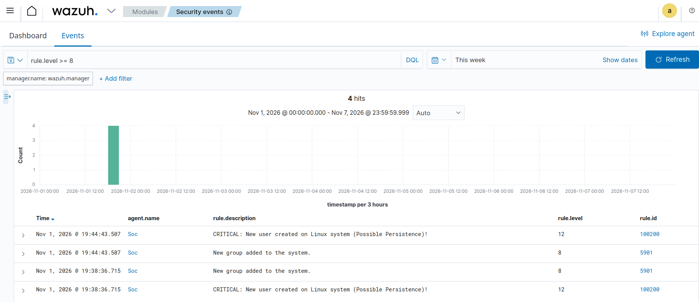

**2. Срабатывание того же кастомного правила и фиксация неудачных попыток `sudo` на Astra Linux:**
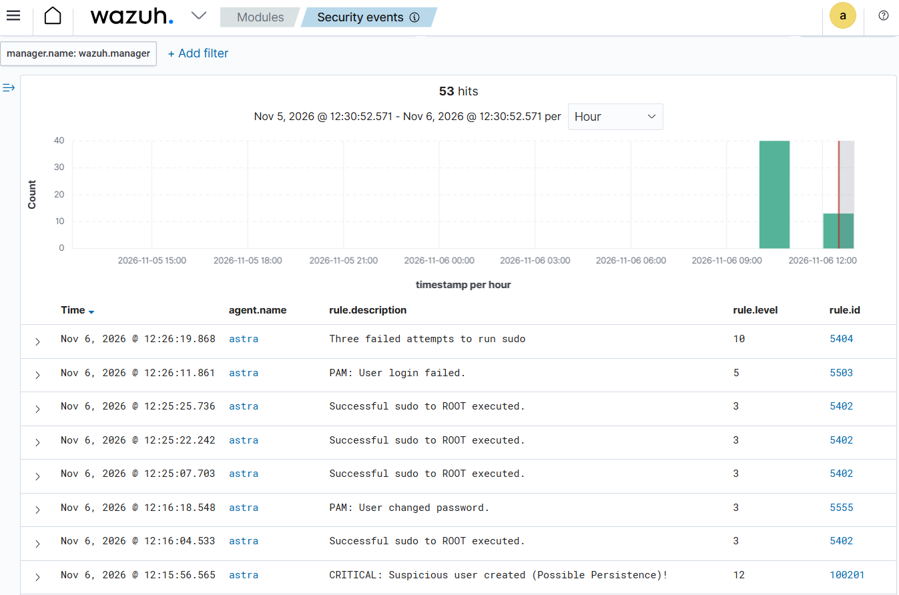

**3. Интерфейс настройки парольной политики в Astra Linux:**
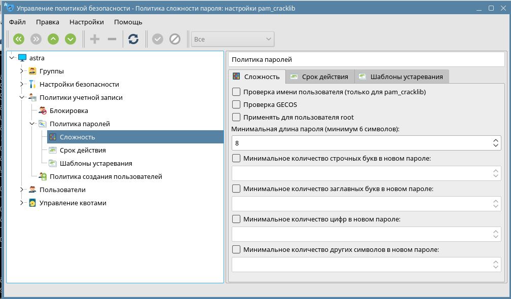

---

### Кейс 2: Оптимизация и снижение шума (Rule Tuning, Linux)
*   **Проблема:** Стандартные модули Wazuh генерировали сотни событий уровня 3-7 (Alert Fatigue).
*   **Решение:** Написаны правила-глушилки (уровень 0), скрывающие системный шум.
*   **Результат:** Дашборд очищен для фокуса на реальных угрозах.

---

### Кейс 3: Настройка Active Response (Автоматическая блокировка, Linux)
*   **Сценарий:** Множественные неудачные попытки входа по SSH (брутфорс).
*   **Действие:** Настроено кастомное правило (`100310`), передающее команду агенту для запуска скрипта `firewall-drop`.
*   **Результат:** IP-адрес атакующего автоматически блокируется в `iptables` на 10 минут (SOAR-подход).

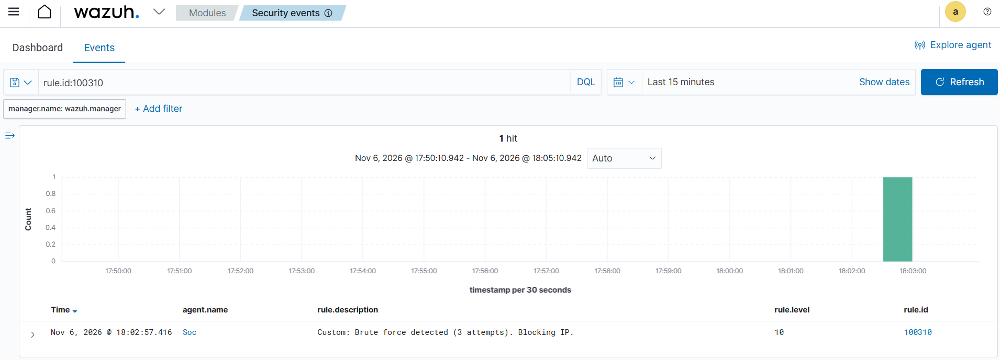

---

### Кейс 4: EDR через Auditd (Детектирование Nmap, Linux)
*   **Сценарий:** Злоумышленник запускает сканер сети `nmap` для разведки.
*   **Действие:** Настроен системный аудит Linux (`Auditd`) на перехват `execve`. Написано правило Wazuh (`100320`).
*   **Результат:** Запуск `nmap` вызывает алерт уровня 10 с маппингом на MITRE ATT&CK (T1046).
*   📄 [Посмотреть отчет об инциденте](./incident-reports/incident_report_T1046.md)

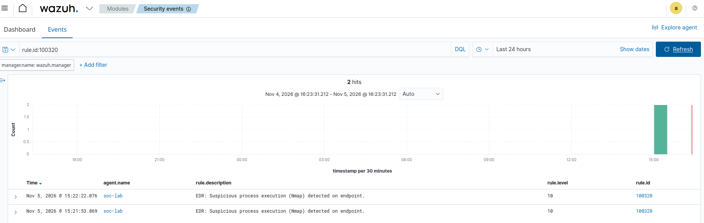

---

### Кейс 5: Подключение Windows и Sysmon (EDR, Windows)
*   **Сценарий:** Подключение рабочей станции Windows 11 к SIEM для глубокого мониторинга.
*   **Действие:** Установлен Wazuh Agent, настроена интеграция с Microsoft Sysmon. Добавлен сбор событий из канала `Microsoft-Windows-Sysmon/Operational`.
*   **Результат:** В SIEM поступает детальная телеметрия о процессах и сетевых подключениях Windows.

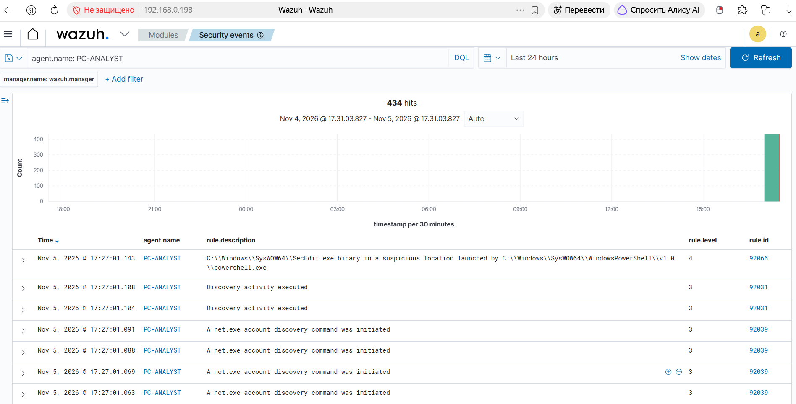

---

### Кейс 6: Threat Hunting на Windows (Создание пользователя)
*   **Сценарий:** Симуляция создания скрытого пользователя (`net user hacker /add`) на Windows.
*   **Действие:** После отсеивания шума (правила `100600`–`100603`), система зафиксировала событие.
*   **Результат:** Wazuh сгенерировал алерты уровня 8 (`60109`, `60110`), подтверждая, что фильтры работают корректно.

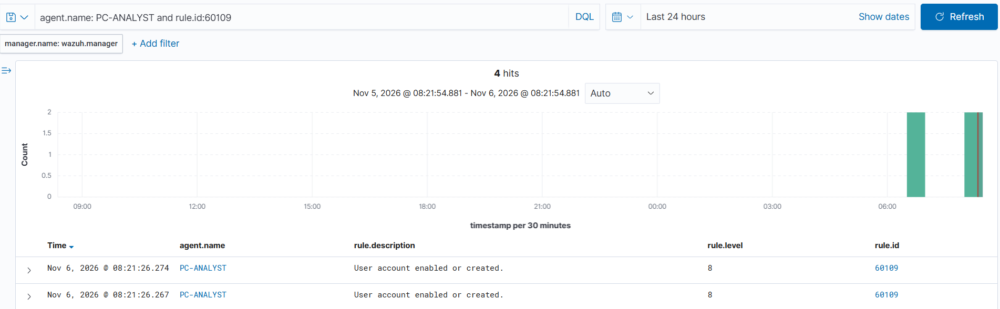

---

### Кейс 7: Настройка оповещений (Alerting) через SMTP
*   **Проблема:** Критические инциденты должны моментально поступать на устройства связи.
*   **Решение:** Развернут Postfix (релей для Docker). Настроена интеграция с Яндекс.Почтой. Задан порог отправки (`email_alert_level > 10`).
*   **Результат:** При детектировании Nmap на почту аналитика приходит письмо с полной телеметрией.

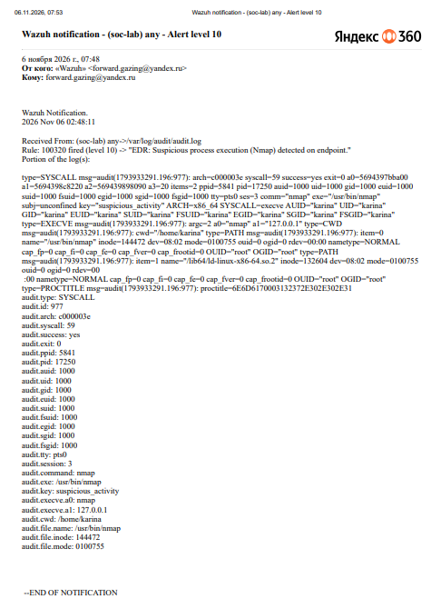

---
### Кейс 8: Симуляция атаки с Kali Linux и проверка Active Response
*   **Сценарий:** Проверка работоспособности EDR-мониторинга и автоматического реагирования (SOAR).
*   **Действие:** В изолированной среде развернут дистрибутив Kali Linux. 
    1. С помощью утилиты `nmap -A` проведено агрессивное сканирование Windows-хоста.
    2. С помощью цикла SSH проведена симуляция брутфорса (подбора пароля) по отношению к серверу Ubuntu.
*   **Результат:** 
    *   EDR (Sysmon + Wazuh) зафиксировал аномальную сетевую активность при сканировании Windows.
    *   При брутфорсе Ubuntu сработало кастомное правило (`100310`) и **Active Response** автоматически заблокировал IP-адрес атакующего (Kali) в `iptables` на 10 минут.

**Сканирование сети с Kali (Nmap):**
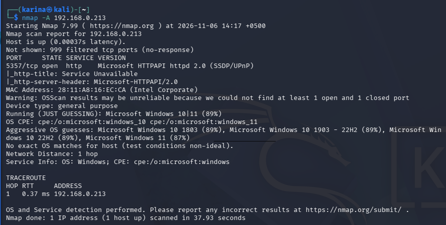

**Автоматическая блокировка IP атакующего (Kali) в Ubuntu:**
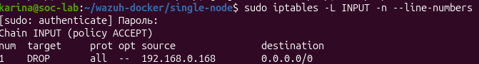

---
### Кейс 9: Валидация EDR с помощью Atomic Red Team (Windows)
*   **Сценарий:** Проверка эффективности настроенных правил Sysmon и Wazuh при симуляции реальных техник атак.
*   **Действие:** На хост Windows установлен фреймворк **Atomic Red Team**. Выполнен тест **T1059.001** (Command and Scripting Interpreter: PowerShell), имитирующий скрытый запуск скрипта с флагами `-nop -w hidden -enc`.
*   **Результат:** EDR-система успешно зафиксировала выполнение подозрительного процесса. Wazuh сгенерировал алерт по правилу `92027` ("Powershell process spawned powershell instance"), подтвердив работоспособность мониторинга. В событии зафиксирована полная командная строка и хеш-сумма процесса.

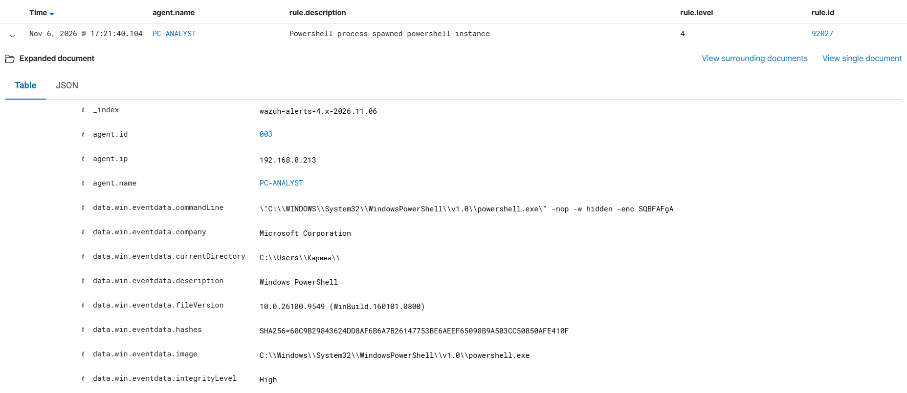

---
## ⚙️ Архитектура развертывания

Лаборатория развернута на базе официального Docker-дистрибутива Wazuh (single-node). 
В данном репозитории собраны **кастомные правила, конфигурации агентов и отчеты об инцидентах**, которые были применены в процессе работы.

**Компоненты лаборатории:**
*   **Хост-система:** VirtualBox, Ubuntu Server 26.04.
*   **SIEM:** Wazuh Manager, Indexer, Dashboard (Docker Compose).
*   **Эндпоинты (подключенные агенты):** 
    *   *Linux (Ubuntu):* Wazuh Agent + Auditd.
    *   *Windows 11:* Wazuh Agent + Sysmon.
    *   *Astra Linux:* Wazuh Agent (мониторинг аутентификации).
*   **Интеграции:** Postfix (SMTP Relay) для отправки алертов на Яндекс.Почту.

*Примечание: Файлы конфигурации Docker (docker-compose.yml, .env) не приложены к репозиторию из соображений безопасности (содержат пароли и сертификаты).*
