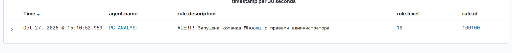
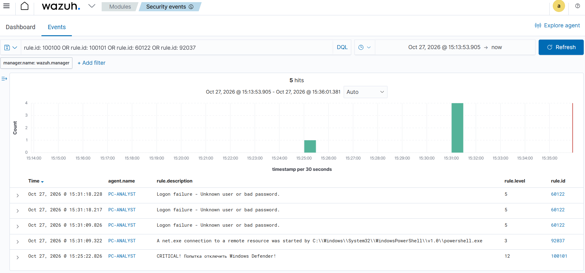

# 🛡️ Практическая лаборатория SOC L1

Этот репозиторий создан для отработки навыков мониторинга и реагирования на инциденты ИБ.

## 🎯 Что внутри
*   **wazuh-rules/** — Кастомные правила для SIEM Wazuh (детектирование разведки и обхода защиты).
*   **incident-reports/** — Примеры отчетов об инцидентах по методике 5W.

## 🛠️ Стек
*   SIEM: Wazuh
*   Мониторинг: Sysmon
*   Среда: Docker, Linux (WSL2), Windows
## 📸 Примеры работы кастомных правил в SIEM Wazuh

В моей лаборатории настроено несколько правил детектирования. Ниже представлены примеры их срабатывания.

### 1. Детектирование разведки (Discovery)
Срабатывание правила на запуск утилиты `whoami` с правами администратора (MITRE T1033). Уровень опасности: 10.

### 2. Детектирование обхода защиты (Defense Evasion)
На скриншоте видно срабатывание критического правила (Level 12) на попытку отключения Windows Defender (MITRE T1562), а также стандартные алерты Wazuh на сетевую активность (`net.exe`) и неудачные входы.

---
**Мотивация:** Проект создан для отработки практических навыков Blue Team. Настройка кастомных правил корреляции помогает понять логику работы SIEM изнутри, а не просто быть пользователем готового интерфейса.
